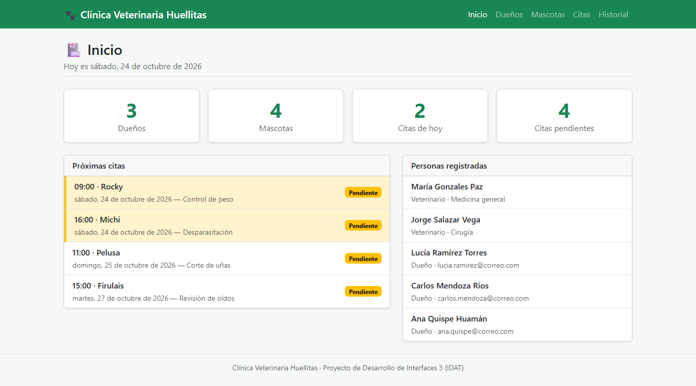
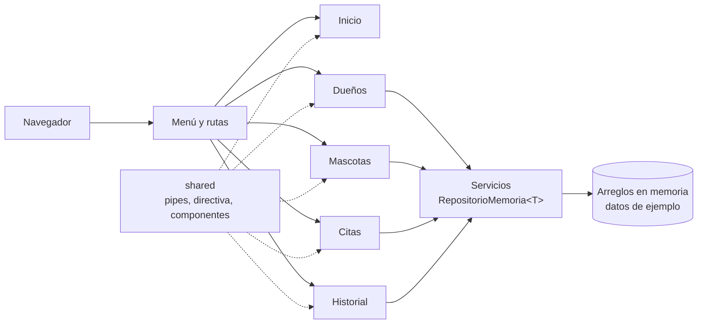
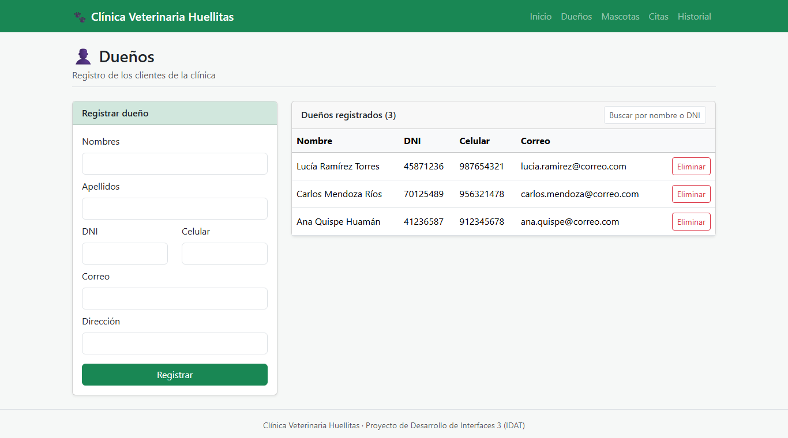
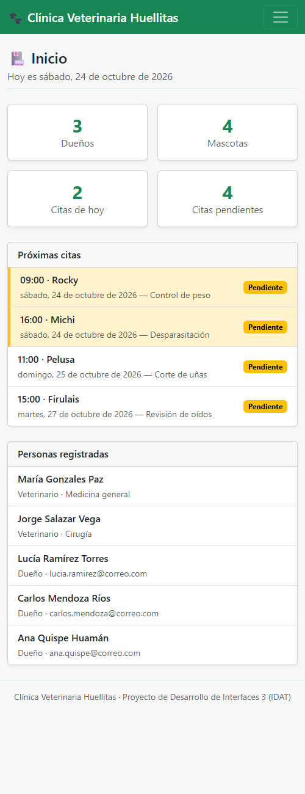
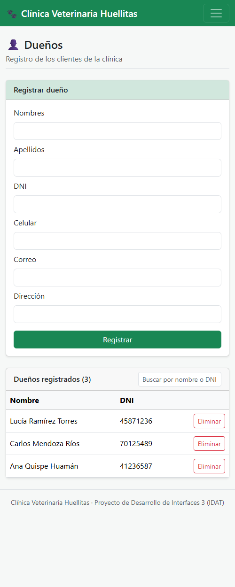

# Clínica Veterinaria Huellitas

Aplicación web para digitalizar la atención de una clínica veterinaria: registro de dueños y mascotas, agenda de citas por semana en horarios libres e historial de atención de cada mascota. Proyecto grupal del curso Desarrollo de Interfaces 3 (IDAT).

   

> 🔒 **Código privado.** Este repositorio muestra el proyecto; el código está disponible a pedido en oropeza.dev@gmail.com.

> 🚧 **En desarrollo.** Listos: estructura, inicio y módulo de dueños. En curso: mascotas, citas e historial.

## Lo más destacado

- **Arquitectura por módulos:** una carpeta por funcionalidad (dueños, mascotas, citas, historial) con rutas propias cargadas bajo demanda (`loadChildren`), más un módulo `shared` con lo común.
- **POO con TypeScript:** clase abstracta `Persona` de la que heredan `Dueno` y `Veterinario`, cada uno con su propia implementación de `describir()`; repositorio genérico `RepositorioMemoria<T>` que extienden todos los servicios.
- **Componentes reutilizables** comunicados con `@Input` y `@Output`: formulario, tabla y tarjeta de mascota.
- **Pipes y directiva propios:** fechas en texto, edad de la mascota, estado de la cita y resaltado automático de las citas de hoy.
- **Formularios reactivos** con validaciones (DNI, celular, correo) y mensajes de error en cada campo.
- **Agenda sin cruces:** solo se ofrecen las horas libres de cada día.
- **Diseño adaptable** con Bootstrap: menú plegable, tablas y tarjetas que se reacomodan en el celular.
- **14 pruebas unitarias** con Vitest sobre pipes, servicios y herencia.

## Arquitectura

Las páginas solo hablan con los servicios; los formularios y tablas reciben datos por `@Input` y avisan por `@Output`, así se pueden reutilizar. Los datos viven en arreglos dentro de los servicios (sin backend).

## Capturas

Datos ficticios de ejemplo.

**Dueños:** formulario reactivo y tabla con buscador

**En el celular**

  
  

## Stack

- **Frontend:** Angular 21 (componentes standalone, ReactiveForms, router con carga diferida) y TypeScript 5.9.
- **Estilos:** Bootstrap 5.3 (navbar, cards, tablas, modal, validación de formularios).
- **Pruebas:** Vitest.

## Contacto

📬 oropeza.dev@gmail.com · [LinkedIn](https://www.linkedin.com/in/jhonatan-oropeza) · [Perfil de GitHub](https://github.com/oropezadev-wq)
